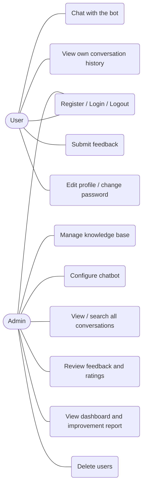
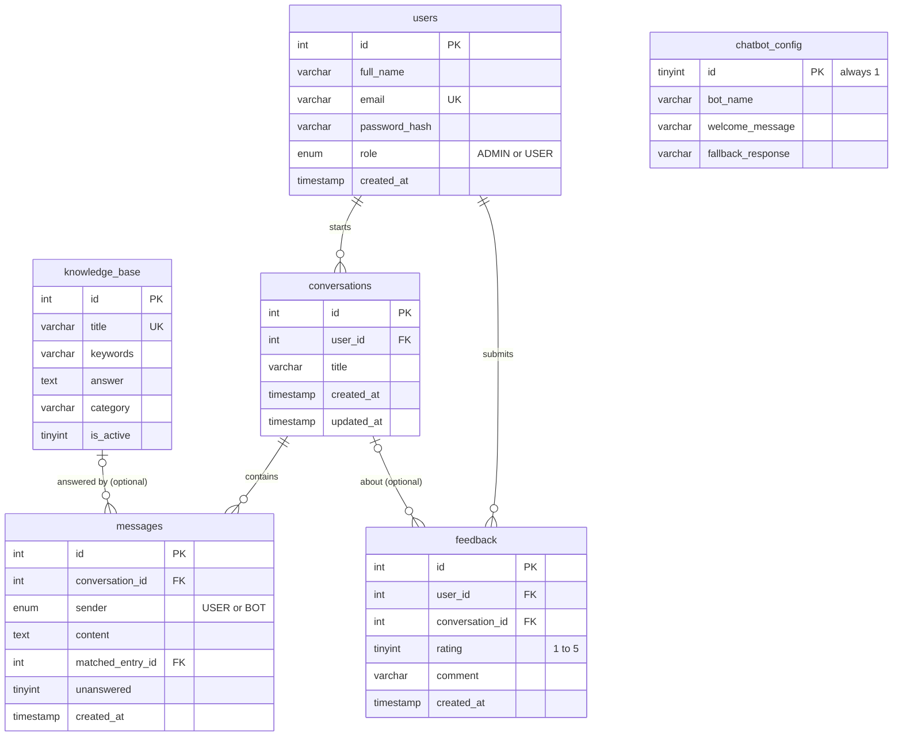

# AI Chatbot System for Customer Support

A server-side rendered web application built with **Core Java, JSP (EL + JSTL), Servlets, JDBC and MySQL**,
packaged as a Maven WAR for **Apache Tomcat 10.1+**. No Spring, no Hibernate/JPA, no JavaScript frontend.

> Honest note about the chatbot: it answers by **normalized text and keyword matching** against a knowledge base
> stored in MySQL. It is **not machine learning**. The core application needs no API key.

---

## 1. Abstract
Customer-support teams answer the same questions again and again. This project provides a web chatbot that answers
common questions from an administrator-managed knowledge base, stores every conversation in MySQL, collects user
feedback, and gives administrators dashboards showing usage, ratings, the questions the bot could not answer and
low-rated interactions, so the knowledge base can be improved over time.

## 2. Problem statement
Support requests are repetitive, answers are inconsistent between staff, and teams have no data about which
questions are failing. A small, explainable system is needed that (a) answers instantly, (b) keeps a permanent
record, (c) measures quality, and (d) lets non-programmers improve the answers.

## 3. Objectives
1. Let users register, log in and chat with a bot that answers from a knowledge base.
2. Persist users, conversations, messages, feedback, knowledge base and bot configuration in MySQL via JDBC.
3. Let administrators manage the knowledge base, bot settings, users, conversations and feedback.
4. Show real statistics (no hard-coded numbers) and a "chatbot improvement" section.
5. Apply security basics: password hashing, role-based access, CSRF protection, output escaping, prepared statements.
6. Demonstrate Core Java concepts in code small enough to explain in a viva.

## 4. Requirements
| Item | Version |
|---|---|
| JDK | 17 or newer (21 is fine) |
| Apache Tomcat | 10.1.x (uses `jakarta.servlet.*`) |
| MySQL | 8.0.16+ (CHECK constraints are enforced from this version) |
| Maven | 3.8+ |

Libraries (all from `pom.xml`): Servlet API 6.0 (provided by Tomcat), JSTL 3.0 (packaged in the WAR, because Tomcat does not ship it),
MySQL Connector/J 8.3, JUnit 5.10 (tests only).

## 5. System architecture
```
Browser --HTTP form--> Filters --> Servlet --> Service --> DAO --JDBC--> MySQL
                       (CSRF,      (controller)  (rules,    (SQL only)
                        auth,           |         validation)
                        admin)          v
                                  request attributes
                                        |
                                        v
                          JSP (EL + JSTL, no scriptlets) --> HTML to browser
```
| Layer | Package | Responsibility |
|---|---|---|
| Model (POJOs) | `com.aichatbot.model` | Private fields + getters/setters; all extend `BaseEntity` (id, createdAt) |
| DAO | `com.aichatbot.dao` | One class per entity; all SQL, `PreparedStatement`, try-with-resources |
| Service | `com.aichatbot.service` | Business rules and validation; `ChatbotService` interface + `ChatbotServiceImpl` |
| Servlet | `com.aichatbot.servlet` | Read request, call service, set attributes, forward/redirect |
| Filter | `com.aichatbot.filter` | `CsrfFilter`, `AuthenticationFilter`, `AdminAuthorizationFilter` |
| Util | `com.aichatbot.util` | `DBConnection`, `PasswordUtil`, `CsrfUtil`, `Validator`, `TextNormalizer` |
| Listener | `com.aichatbot.listener` | Startup: first-admin creation + analytics thread pool; shutdown cleanup |
| Views | `WEB-INF/views` | JSP pages (hidden from direct URL access, only reachable through servlets) |

**Deviation from the suggested structure:** all JSPs except `index.jsp` live under `WEB-INF/views/` instead of
`webapp/user`, `webapp/admin`. This means nobody can open a JSP directly without going through its servlet
(and its filters). The page names are unchanged. Extra classes added: `BaseServlet`, `DashboardServlet`, `ProfileServlet`,
`CsrfFilter`, `AppContextListener`, `KnowledgeBaseService`, `FeedbackService`, `ResponseStrategy` + two strategies, `BaseEntity`, `CsrfUtil`, `Validator`, `TextNormalizer`.

### URL map
| URL | Servlet | Who |
|---|---|---|
| `/`, `/login`, `/register`, `/logout` | `index.jsp`, Login/Register/LogoutServlet | everyone |
| `/user/dashboard`, `/user/chat`, `/user/history`, `/user/conversation?id=`, `/user/feedback`, `/user/profile` | Dashboard/Chat/Conversation/Feedback/ProfileServlet | logged-in users |
| `/admin/dashboard`, `/admin/users`, `/admin/conversations`, `/admin/knowledge`, `/admin/feedback`, `/admin/configuration` | AdminDashboard/Conversation/KnowledgeBase/Feedback/ConfigurationServlet | ADMIN only |

## 6. Use-case diagram

(Paste the block into <https://mermaid.live> to export a PNG for your report.)

## 7. Database ER diagram

Deleting a user cascades to their conversations, messages and feedback. Deleting a conversation keeps its feedback
(`conversation_id` becomes NULL). Deleting a knowledge-base entry keeps old messages (`matched_entry_id` becomes NULL).

## 8. Database setup
```bash
mysql -u root -p < database.sql
```
Creates `ai_chatbot_db`, the six tables and sample data (9 knowledge-base entries + default bot configuration).
The script is safe to re-run: it never drops tables and uses `INSERT IGNORE` for the samples.

**Connection settings** are read from environment variables first, then Java system properties, then `src/main/resources/db.properties`:

| Variable | Default |
|---|---|
| `DB_URL` | `jdbc:mysql://localhost:3306/ai_chatbot_db?useSSL=false&allowPublicKeyRetrieval=true&serverTimezone=UTC&characterEncoding=UTF-8` |
| `DB_USER` | `root` |
| `DB_PASSWORD` | *(empty)* - set it with the environment variable, never commit it |

## 9. Java and Tomcat setup
1. Install JDK 17+ and check `java -version` and `javac -version`.
2. Download Tomcat 10.1.x (zip/tar.gz, not the Windows service installer, so environment variables are easy to pass) and unzip it. Set `CATALINA_HOME` to that folder.
3. Install MySQL 8 and Maven; check `mvn -version`.

## 10. Creating the first admin account
There is **no admin password in the code or in `database.sql`**. The first admin is created at startup from environment variables:
```
ADMIN_EMAIL=admin@example.com     (required)
ADMIN_PASSWORD=<your own password, min 8 chars, letter + digit>   (required)
ADMIN_NAME=Administrator          (optional)
```
When Tomcat starts, `AppContextListener` creates that account **only if no admin exists yet** (check `logs/catalina.out` for the message).
After the first start you may unset the variables. Self-registration always creates role `USER`; there is no way to register as admin.

## 11. Maven build
```bash
mvn clean package            # compiles, runs tests, builds target/ai-chatbot-system.war
mvn clean package -DskipTests
```

## 12. Deployment (Tomcat 10.1)
**Windows (cmd):**
```bat
set DB_USER=root
set DB_PASSWORD=your_mysql_password
set ADMIN_EMAIL=admin@example.com
set ADMIN_PASSWORD=ChangeMe123
copy target\ai-chatbot-system.war %CATALINA_HOME%\webapps\
%CATALINA_HOME%\bin\catalina.bat run
```
**Linux / macOS:**
```bash
export DB_USER=root DB_PASSWORD='your_mysql_password'
export ADMIN_EMAIL=admin@example.com ADMIN_PASSWORD='ChangeMe123'
cp target/ai-chatbot-system.war "$CATALINA_HOME/webapps/"
"$CATALINA_HOME/bin/catalina.sh" run
```
Open <http://localhost:8080/ai-chatbot-system/>. The environment variables must be set in the **same terminal that starts Tomcat**.
To redeploy: stop Tomcat, delete `webapps/ai-chatbot-system/` and the old WAR, copy the new WAR, start again.
All data lives in MySQL, so it survives Tomcat restarts.

## 13. Test instructions
```bash
mvn test
```
| Test class | What it proves | Needs MySQL? |
|---|---|---|
| `PasswordUtilTest` | hashing, salting, verification | no |
| `ChatbotServiceImplTest` | greeting/keyword/phrase matching, whole-word rule, fallback, input validation | no |
| `AuthServiceTest` | registration (role forced to USER, hashed password, duplicate email, validation), login, first-admin rule | no (fake DAO) |
| `KnowledgeBaseServiceTest` | add / edit / delete / validation | no (fake DAO) |
| `FeedbackServiceTest` | rating range, optional fields, cannot attach feedback to another user's conversation | no (fake DAO) |
| `AccessControlFilterTest` | redirect when not logged in, 403 for non-admin, CSRF accept/reject, token creation | no (fake request objects) |
| `JdbcIntegrationTest` | real INSERT/SELECT/UPDATE/DELETE, transaction, cascade, ownership, duplicate key, config | **yes**, auto-skipped if MySQL is unreachable |

To run the JDBC tests, run `database.sql` first and set `DB_USER` / `DB_PASSWORD`. They only touch rows they create themselves
(and restore the chatbot configuration afterwards), but use a development database anyway.

## 14. Features
- Registration, login, logout, PBKDF2 password hashing, session id renewal after login, 30-minute session timeout, HttpOnly cookie.
- Role-based access (`USER` / `ADMIN`) by filters; conversation ownership checked in SQL (`WHERE id=? AND user_id=?`).
- CSRF token on every state-changing form; Post/Redirect/Get after successful submissions.
- Chat page with USER/BOT bubbles, timestamps, validation errors, new-conversation link; all messages saved in MySQL.
- Keyword matching with two interchangeable strategies (`ResponseStrategy`), fallback reply from the configuration.
- Admin: statistics from the database, knowledge-base CRUD + search, bot configuration, user list/delete, conversation search/inspection, feedback filtering and averages, improvement report (frequent unanswered questions with an "Add answer" shortcut, low-rated feedback).
- Output escaping with `<c:out>` everywhere; scriptlets are forbidden in `web.xml` (`scripting-invalid`).
- Works without JavaScript (the only JS is an optional `confirm()` prompt before a delete).

## 15. Limitations
- Keyword matching only: it does not understand meaning, spelling mistakes or word forms (add both "refund" and "refunds" as keywords).
- No account lockout / rate limiting on login, no email verification, no "forgot password" email flow.
- Each request opens a new JDBC connection (simple to explain; a connection pool would be faster under load).
- Admin search uses `LIKE '%text%'`, which is fine for a college-scale dataset but not for millions of rows.
- Creating a new conversation and saving its first exchange are two separate DB operations (the exchange itself is one transaction).
- Passwords reach the server over plain HTTP unless you put Tomcat behind HTTPS; enable HTTPS before any real deployment.

## 16. Future enhancements
- Optional LLM answer step called server-side from Java (fallback to the knowledge base when no API key is configured).
- Connection pooling (HikariCP or Tomcat `DataSource` via JNDI), pagination for long lists, login throttling.
- Export of conversations/feedback to CSV, richer analytics charts, multi-language knowledge base.
- Email notification when the bot cannot answer.

## 17. More documents
- [`docs/DEMO_SCRIPT.md`](docs/DEMO_SCRIPT.md) - step-by-step live demonstration
- [`docs/VIVA_QA.md`](docs/VIVA_QA.md) - Java, JDBC and Servlet/JSP viva questions with answers
